# ss-drawer

<!-- Auto Generated Below -->

## Overview

A panel that enters from an edge of the viewport.

Modal by default, like `ss-modal`: focus is trapped, the page behind is
covered and stops scrolling. With `modal="false"` it is a side panel that
leaves the page usable: no backdrop, no trap, and Escape closes it only when
pressed inside it.

Rendered scoped rather than shadow, for the reason `ss-modal` is: the focus
trap has to see the caller's controls.

## Properties

| Property             | Attribute             | Description                                                                 | Type                                                     | Default     |
| -------------------- | --------------------- | --------------------------------------------------------------------------- | -------------------------------------------------------- | ----------- |
| `accessibilityLabel` | `accessibility-label` | Accessible name, for a drawer with no visible heading.                      | `string`                                                 | `undefined` |
| `closeOnBackdrop`    | `close-on-backdrop`   | Pressing the backdrop closes a modal drawer.                                | `boolean`                                                | `true`      |
| `closeOnEscape`      | `close-on-escape`     | Escape closes the drawer (non-modal: only when pressed inside it).          | `boolean`                                                | `true`      |
| `dismissLabel`       | `dismiss-label`       | Accessible name of the close button. Translate it.                          | `string`                                                 | `'Close'`   |
| `dismissible`        | `dismissible`         | Shows a close button in the header.                                         | `boolean`                                                | `true`      |
| `heading`            | `heading`             | Heading text.                                                               | `string`                                                 | `undefined` |
| `inlineStyles`       | `inline-styles`       | Inline CSS styles applied to the panel element.                             | `string \| { [x: string]: string; }`                     | `undefined` |
| `modal`              | `modal`               | Takes over the page (backdrop, focus trap). `false` leaves the page usable. | `boolean`                                                | `true`      |
| `open`               | `open`                | Whether the drawer is showing. Updated when it is dismissed, and reflected. | `boolean`                                                | `false`     |
| `placement`          | `placement`           | The edge it enters from. `start` and `end` follow the writing direction.    | `"bottom" \| "end" \| "start" \| "top"`                  | `'end'`     |
| `size`               | `size`                | Width (start, end) or height (top, bottom) of the panel.                    | `"2xl" \| "3xl" \| "lg" \| "md" \| "sm" \| "xl" \| "xs"` | `'md'`      |
| `xId`                | `x-id`                | Id applied to the panel element.                                            | `string`                                                 | `undefined` |

## Events

| Event          | Description                                                                                   | Type                                            |
| -------------- | --------------------------------------------------------------------------------------------- | ----------------------------------------------- |
| `ssOpenChange` | Emitted when the drawer opens or closes through an interaction; detail contains xId and open. | `CustomEvent<{ xId?: string; open: boolean; }>` |

## Slots

| Slot       | Description                                        |
| ---------- | -------------------------------------------------- |
|            | The panel's content.                               |
| `"footer"` | Actions.                                           |
| `"header"` | Rich header content; overrides the `heading` prop. |

## Dependencies

### Depends on

- [ss-typography](../../atoms/ss-typography)

### Graph

```mermaid
graph TD;
  ss-drawer --> ss-typography
  style ss-drawer fill:#000,stroke:#fff,stroke-width:4px
```

----------------------------------------------

*Built with love ❤️ by [Slice Soft](https://slicesoft.dev/) Team*
